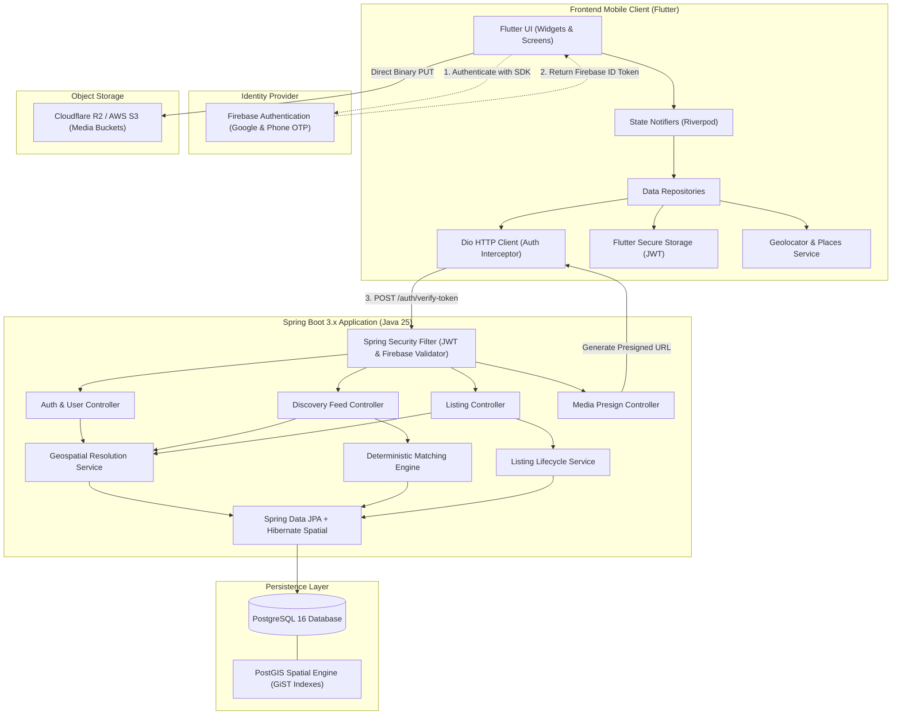
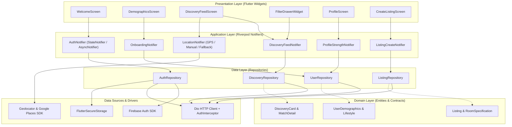
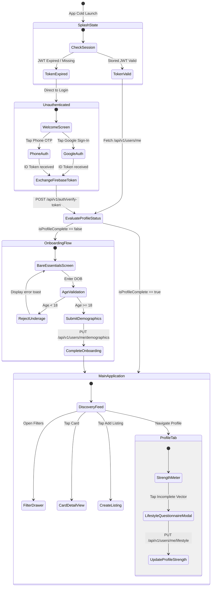
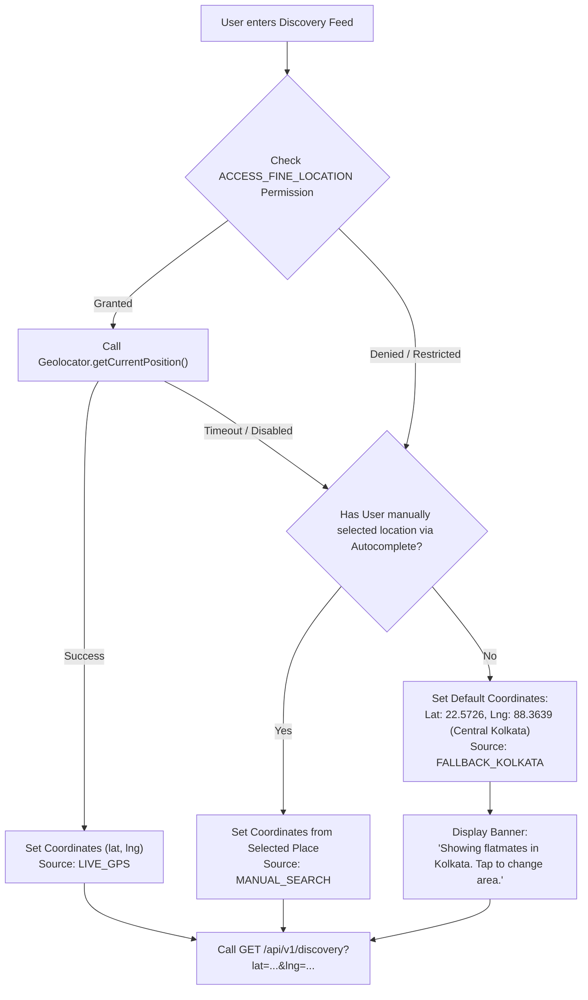
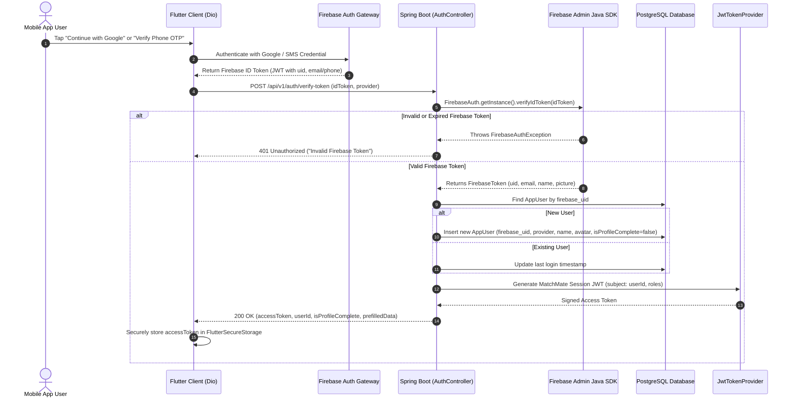
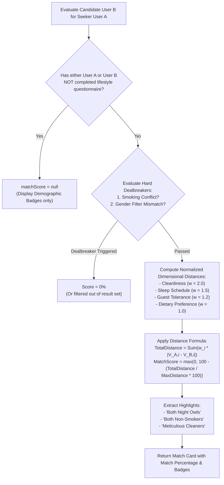
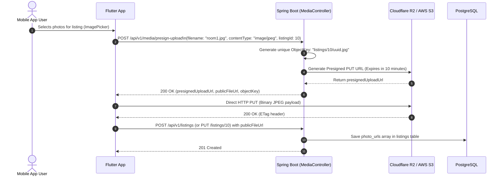
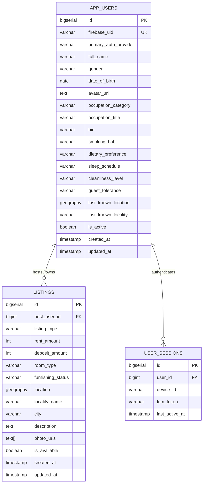

# MatchMate: Technical Architecture & System Specification

## 1. System Overview & Core Philosophy

**MatchMate** is a high-performance, hyper-local B2C roommate and flatmate matching platform. It bridges the gap between individuals seeking shared accommodation and those with available rooms, using deterministic lifestyle compatibility heuristics and sub-kilometer spatial radius queries.

The platform is engineered around a client-server paradigm utilizing a **Flutter mobile client** (iOS & Android) communicating over HTTPS/REST with a **Java 25 / Spring Boot 3.x** micro-service, backed by **PostgreSQL 16 + PostGIS** for geospatial computation and **Cloudflare R2 / AWS S3** for zero-latency direct media uploads.

```
+---------------------------------------------------------------------------------------------------+
|                                      MatchMate System Landscape                                   |
|                                                                                                   |
|   [ Mobile Client: Flutter ]                                                                      |
|             │                                                                                     |
|             ├── (1) Firebase Auth SDK ─────────► Google Sign-In & Phone SMS OTP                   |
|             ├── (2) HTTPS / REST (Dio) ────────► Spring Boot 3.x (Java 25 LTS)                   |
|             │                                       ├── Spring Security (Stateless JWT Filter)    |
|             │                                       ├── Matching Heuristic Engine                 |
|             │                                       ├── Geospatial Query Service (Hibernate)      |
|             │                                       └── Spring Data JPA / Flyway                  |
|             │                                              │                                      |
|             │                                              ▼                                      |
|             │                                   [ PostgreSQL 16 + PostGIS ]                       |
|             │                                     (Geography 4326, GiST Spatial Indexes)          |
|             │                                                                                     |
|             └── (3) Direct Media Upload ───────► Cloudflare R2 / AWS S3 (Presigned S3 URLs)       |
+---------------------------------------------------------------------------------------------------+
```

### Core Product Principles

1. **Progressive Profiling (< 20 Seconds to Feed):**
   Traditional roommate apps lose 60%+ of potential users due to upfront 30-question personality surveys. MatchMate defers all non-essential questions. Mandatory registration requires only four fields: Full Name, Gender, Date of Birth (evaluated against an explicit $Age \ge 18$ validation), and Profile Avatar. All lifestyle attributes are deferred to the gamified **Profile Strength** center.
2. **Decoupled Geospatial Resolution:**
   Users are never blocked if location permission is denied. Physical coordinates are resolved via a resilient three-tier hierarchy:
   - **Tier 1 (Active GPS):** Runtime `ACCESS_FINE_LOCATION` coordinates via `Geolocator`.
   - **Tier 2 (Manual Autocomplete):** Google Places search across any city or neighborhood.
   - **Tier 3 (Metropolitan Fallback):** Default regional centroid (Central Kolkata, West Bengal: `POINT(88.3639 22.5726)`).
   Exact geocoded coordinates are strictly mandatory only when publishing a listing.
3. **Deterministic Compatibility Matching:**
   No black-box machine learning models. Compatibility scoring operates on a transparent, normalized geometric distance model across lifestyle vectors (Cleanliness, Sleep Schedule, Guest Tolerance, Dietary Preference) combined with non-negotiable hard binary dealbreakers (e.g., Smoking Habit, Gender mismatch).

---

## 2. End-to-End System Architecture



---

## 3. Frontend System Design (Flutter Mobile Client)

### 3.1 Architecture Pattern: Feature-First Clean Architecture

The Flutter client adopts a **Feature-First Clean Architecture** with **Riverpod (2.x)** for immutable state management and dependency injection.

```
lib/
├── app/
│   ├── app.dart                   # MaterialApp, routing setup, global theme
│   ├── routes/                    # GoRouter route definitions & guards
│   └── theme/                     # MatchMate Design System (Colors, Typography)
├── core/
│   ├── constants/                 # App constants, Kolkata defaults, API endpoints
│   ├── network/                   # Dio instance, Auth Interceptor, Error Handlers
│   ├── storage/                   # FlutterSecureStorage wrappers (Tokens, user session)
│   └── utils/                     # Geo math, date formatters, validators
└── features/
    ├── auth/                      # Firebase Google/Phone sign-in, token exchange
    │   ├── data/                  # AuthApi, AuthRepositoryImpl
    │   ├── domain/                # AuthUser model, AuthTokens
    │   └── presentation/          # WelcomeScreen, PhoneOtpScreen, AuthNotifier
    ├── onboarding/                # Bare Essentials screen
    │   ├── data/                  # DemographicsApi, UserRepositoryImpl
    │   ├── domain/                # UserDemographics model
    │   └── presentation/          # DemographicsScreen, OnboardingNotifier
    ├── discovery/                 # Feed, spatial query, matching cards
    │   ├── data/                  # DiscoveryApi, DiscoveryRepositoryImpl
    │   ├── domain/                # DiscoveryCard, FeedFilter model
    │   └── presentation/          # FeedScreen, FilterDrawer, DiscoveryNotifier
    ├── listings/                  # Room & flat listing creation and viewing
    │   ├── data/                  # ListingApi, MediaUploadService
    │   ├── domain/                # Listing, ListingFormInput
    │   └── presentation/          # ListingDetailScreen, CreateListingScreen
    └── profile/                   # Gamified lifestyle vectors & strength meter
        ├── data/                  # ProfileApi
        ├── domain/                # LifestyleProfile, CompatibilityScore
        └── presentation/          # ProfileScreen, LifestyleQuizModal
```

### 3.2 Frontend Architecture & Riverpod Dependency Graph



### 3.3 App State Machine & Navigation Workflow



### 3.4 Geolocation Resolution Engine

The Flutter app resolves search coordinates autonomously without trapping the user in an onboarding permission loop:



---

## 4. Backend System Design (Spring Boot 3.x / Java 25)

### 4.1 Layered Architecture Pattern

The backend is built as a clean, layered Spring Boot 3.x system with strict boundaries between REST transport, security context, domain logic, and persistence.

```
src/main/java/com/matcher/matchmate_backend/
├── config/
│   ├── SecurityConfig.java              # Stateless SecurityFilterChain, CORS, permitAll routes
│   ├── FirebaseConfig.java              # FirebaseApp & FirebaseAuth bean initialization
│   └── JacksonSpatialConfig.java        # JTS Geometry serializer / deserializer
├── controller/
│   ├── AuthController.java              # /api/v1/auth/**
│   ├── UserController.java              # /api/v1/users/**
│   ├── DiscoveryController.java         # /api/v1/discovery/**
│   ├── ListingController.java           # /api/v1/listings/**
│   └── MediaController.java             # /api/v1/media/**
├── security/
│   ├── JwtTokenProvider.java            # JWT generation, signing (HS256/RS256), validation
│   ├── JwtAuthenticationFilter.java     # OncePerRequestFilter parsing Authorization header
│   └── AuthenticatedUserPrincipal.java  # UserDetails containing AppUser.id & roles
├── service/
│   ├── AuthService.java                 # Firebase ID token verification & user auto-provisioning
│   ├── UserService.java                 # Demographics updates, lifestyle vector scoring
│   ├── DiscoveryService.java            # Spatial candidate queries + Compatibility ranking
│   ├── MatchingHeuristicEngine.java     # Deterministic lifestyle distance calculations
│   ├── ListingService.java              # Listing creation, geocoding validation, active status
│   └── MediaStorageService.java         # Cloudflare R2 / AWS S3 presigned PUT URL generation
├── repository/
│   ├── AppUserRepository.java          # User persistence & custom spatial queries
│   └── ListingRepository.java          # PostGIS ST_DWithin & ST_Distance native spatial queries
├── model/
│   ├── entity/
│   │   ├── AppUser.java                 # JPA Entity mapped to app_users
│   │   └── Listing.java                 # JPA Entity mapped to listings
│   └── enums/
│       ├── Gender.java                  # MALE, FEMALE, NON_BINARY
│       ├── CleanlinessLevel.java        # METICULOUS, MODERATE, RELAXED
│       ├── SleepSchedule.java           # EARLY_BIRD, NIGHT_OWL, FLEXIBLE
│       ├── SmokingHabit.java            # NON_SMOKER, OUTSIDE_ONLY, REGULAR_SMOKER
│       ├── DietaryPreference.java       # VEGETARIAN, VEGAN, NON_VEGETARIAN, FLEXIBLE
│       ├── GuestTolerance.java          # QUIET_HAVEN, OCCASIONAL_GUESTS, SOCIAL_HUB
│       └── ListingType.java             # HAVE_ROOM, NEED_ROOM
└── dto/
    ├── request/                         # TokenVerifyRequest, DemographicsRequest, etc.
    └── response/                        # AuthTokenResponse, DiscoveryFeedResponse, etc.
```

### 4.2 Firebase Token Verification & Session JWT Handshake

MatchMate decouples third-party authentication tokens from internal session identity. The client signs in via Firebase SDK, then exchanges the Firebase ID Token for a short-lived internal JWT token signed with an HMAC-SHA256 secret.



### 4.3 Geospatial Search & Spatial Query Optimization

Spatial resolution relies directly on PostgreSQL PostGIS native geometric spherical calculations using the `GEOGRAPHY(Point, 4326)` coordinate type.

- **Coordinate Standard:** WGS 84 (SRID 4326). Points stored as `ST_SetSRID(ST_MakePoint(longitude, latitude), 4326)::geography`.
- **Spatial Indexing:** GiST (Generalized Search Tree) indexes on both `app_users.last_known_location` and `listings.location`.
- **Metric Distance Calculation:** `ST_Distance(location, target_point)` computes true geodesic distance over the WGS 84 spheroid in meters.
- **Bounding Box Pre-filtering:** `ST_DWithin(location, target_point, radius_in_meters)` efficiently uses the GiST index to eliminate non-qualifying records before computing exact spherical distances.

#### Spatial Native Query Pattern:
```sql
SELECT 
    l.id,
    l.host_user_id,
    l.listing_type,
    l.rent_amount,
    l.deposit_amount,
    l.room_type,
    l.furnishing_status,
    l.locality_name,
    l.city,
    l.photo_urls,
    ST_Distance(l.location, ST_SetSRID(ST_MakePoint(:lng, :lat), 4326)::geography) / 1000.0 AS distance_km
FROM listings l
WHERE l.is_available = TRUE
  AND ST_DWithin(l.location, ST_SetSRID(ST_MakePoint(:lng, :lat), 4326)::geography, :radiusMeters)
ORDER BY distance_km ASC
LIMIT :limit OFFSET :offset;
```

### 4.4 Deterministic Compatibility Matching Engine

MatchMate uses a mathematical heuristic to score compatibility between a searching user ($A$) and a candidate host/roommate ($B$).



#### Mathematical Specification:

1. **Ordinal Vector Encoding:**
   Lifestyle attributes are mapped onto discrete normalized scales $[0.0, 1.0]$:
   - **Cleanliness:** `METICULOUS` = 1.0, `MODERATE` = 0.5, `RELAXED` = 0.0
   - **Sleep Schedule:** `EARLY_BIRD` = 1.0, `FLEXIBLE` = 0.5, `NIGHT_OWL` = 0.0
   - **Guest Tolerance:** `QUIET_HAVEN` = 0.0, `OCCASIONAL_GUESTS` = 0.5, `SOCIAL_HUB` = 1.0
   - **Dietary Preference:** `VEGAN` = 1.0, `VEGETARIAN` = 0.8, `FLEXIBLE` = 0.4, `NON_VEGETARIAN` = 0.0

2. **Hard Dealbreaker Rules:**
   - If User $A$ has `smokingHabit == NON_SMOKER` and User $B$ has `smokingHabit == REGULAR_SMOKER`: $\text{Score} = 0\%$ (immediate disqualification).
   - If User $A$ selects a strict gender restriction (e.g. `FEMALE_ONLY`) and User $B$ does not match: User $B$ is excluded at the database layer.

3. **Weighted Distance & Percentage Formulation:**
   $$\text{Distance} = \sum_{i=1}^{n} \left( w_i \times |V_{A,i} - V_{B,i}| \right)$$
   $$\text{MaxDistance} = \sum_{i=1}^{n} w_i = 2.0 + 1.5 + 1.2 + 1.0 = 5.7$$
   $$\text{Compatibility Percentage} = \max\left(0, \text{round}\left( 100 - \left( \frac{\text{Distance}}{\text{MaxDistance}} \times 100 \right) \right)\right)$$

### 4.5 Media Storage & Presigned Upload Pipeline

To maintain zero-latency in the backend application container, image binaries never traverse the Spring Boot server. Spring Boot signs upload operations with time-limited AWS S3 / Cloudflare R2 Presigned URLs.



---

## 5. Database Architecture & Schema Specification

### 5.1 Entity-Relationship (ER) Diagram



### 5.2 Flyway Database Migrations

#### `V1__init_schema.sql` (Core Users & PostGIS Extension)
```sql
CREATE EXTENSION IF NOT EXISTS postgis;

-- 1. Base Users Table (Lean Core + Progressive Vectors)
CREATE TABLE app_users (
    id BIGSERIAL PRIMARY KEY,
    firebase_uid VARCHAR(128) NOT NULL UNIQUE,
    primary_auth_provider VARCHAR(20) NOT NULL, -- 'GOOGLE', 'PHONE'
    
    -- Mandatory Core (Captured in Step 2 Onboarding)
    full_name VARCHAR(100) NOT NULL,
    gender VARCHAR(20) NOT NULL,                 -- 'MALE', 'FEMALE', 'NON_BINARY'
    date_of_birth DATE NOT NULL,
    avatar_url TEXT,
    
    -- Optional Context (Updated in Profile Tab)
    occupation_category VARCHAR(30),             -- 'STUDENT', 'WORKING_PROFESSIONAL', 'FREELANCER', 'OTHER'
    occupation_title VARCHAR(100),               -- e.g., 'Software Engineer'
    bio VARCHAR(500),
    
    -- Progressive Lifestyle Habits (Nullable until answered)
    smoking_habit VARCHAR(20),                   -- 'NON_SMOKER', 'OUTSIDE_ONLY', 'REGULAR_SMOKER'
    dietary_preference VARCHAR(20),              -- 'VEGETARIAN', 'VEGAN', 'NON_VEGETARIAN', 'FLEXIBLE'
    sleep_schedule VARCHAR(20),                  -- 'EARLY_BIRD', 'NIGHT_OWL', 'FLEXIBLE'
    cleanliness_level VARCHAR(20),               -- 'METICULOUS', 'MODERATE', 'RELAXED'
    guest_tolerance VARCHAR(20),                 -- 'QUIET_HAVEN', 'OCCASIONAL_GUESTS', 'SOCIAL_HUB'
    
    -- Location Context (Last active anchor, default: Kolkata)
    last_known_location GEOGRAPHY(Point, 4326) DEFAULT ST_SetSRID(ST_MakePoint(88.3639, 22.5726), 4326)::geography,
    last_known_locality VARCHAR(100) DEFAULT 'Kolkata',
    
    is_active BOOLEAN NOT NULL DEFAULT TRUE,
    created_at TIMESTAMP WITH TIME ZONE DEFAULT CURRENT_TIMESTAMP,
    updated_at TIMESTAMP WITH TIME ZONE DEFAULT CURRENT_TIMESTAMP
);

-- Geospatial & Search Indexes
CREATE INDEX idx_app_users_location ON app_users USING GIST(last_known_location);
CREATE INDEX idx_app_users_gender ON app_users(gender);
CREATE INDEX idx_app_users_active ON app_users(is_active);
```

#### `V2__create_listings_schema.sql` (Rooms & Shared Accommodations)
```sql
-- 2. Room & Flat Listings Table
CREATE TABLE listings (
    id BIGSERIAL PRIMARY KEY,
    host_user_id BIGINT NOT NULL REFERENCES app_users(id) ON DELETE CASCADE,
    listing_type VARCHAR(20) NOT NULL,           -- 'HAVE_ROOM', 'NEED_ROOM'
    
    -- Financials & Space
    rent_amount INT NOT NULL,
    deposit_amount INT NOT NULL,
    room_type VARCHAR(20) NOT NULL,              -- 'PRIVATE', 'SHARED'
    furnishing_status VARCHAR(20) NOT NULL,      -- 'FURNISHED', 'SEMI_FURNISHED', 'UNFURNISHED'
    
    -- Strict Spatial Coordinates for Listings
    location GEOGRAPHY(Point, 4326) NOT NULL,
    locality_name VARCHAR(150) NOT NULL,        -- e.g., 'Salt Lake, Sector V'
    city VARCHAR(100) NOT NULL,                 -- e.g., 'Kolkata'
    
    description TEXT,
    photo_urls TEXT[] DEFAULT '{}',             -- Direct URLs on S3/R2
    is_available BOOLEAN NOT NULL DEFAULT TRUE,
    created_at TIMESTAMP WITH TIME ZONE DEFAULT CURRENT_TIMESTAMP,
    updated_at TIMESTAMP WITH TIME ZONE DEFAULT CURRENT_TIMESTAMP
);

-- Spatial & Query Indexes
CREATE INDEX idx_listings_location ON listings USING GIST(location);
CREATE INDEX idx_listings_rent ON listings(rent_amount);
CREATE INDEX idx_listings_host_id ON listings(host_user_id);
CREATE INDEX idx_listings_available ON listings(is_available);
```

---

## 6. REST API Interface Specification

### 6.1 Verify Firebase Token & Handshake

- **Route:** `POST /api/v1/auth/verify-token`
- **Access:** Public
- **Request Body:**
```json
{
  "idToken": "eyJhbGciOiJSUzI1NiIsImtpZCI6...",
  "provider": "GOOGLE"
}
```
- **Response (200 OK):**
```json
{
  "accessToken": "eyJhbGciOiJIUzI1NiIsInR5cCI6IkpXVCJ9...",
  "tokenType": "Bearer",
  "expiresIn": 86400,
  "userId": 1,
  "isProfileComplete": false,
  "prefilledData": {
    "fullName": "Pranay Koley",
    "avatarUrl": "https://lh3.googleusercontent.com/a/..."
  }
}
```

### 6.2 Complete Bare Essentials (Onboarding)

- **Route:** `PUT /api/v1/users/me/demographics`
- **Access:** Authenticated (`Bearer <JWT>`)
- **Request Body:**
```json
{
  "fullName": "Pranay Koley",
  "gender": "MALE",
  "dateOfBirth": "1998-11-15",
  "avatarUrl": "https://storage.matchmate.app/avatars/1.jpg",
  "occupationCategory": "WORKING_PROFESSIONAL",
  "occupationTitle": "Software Engineer"
}
```
- **Response (200 OK):**
```json
{
  "userId": 1,
  "fullName": "Pranay Koley",
  "gender": "MALE",
  "age": 27,
  "profileStrength": 40,
  "isProfileComplete": true
}
```

### 6.3 Update Progressive Lifestyle Vector

- **Route:** `PUT /api/v1/users/me/lifestyle`
- **Access:** Authenticated (`Bearer <JWT>`)
- **Request Body:**
```json
{
  "smokingHabit": "NON_SMOKER",
  "dietaryPreference": "NON_VEGETARIAN",
  "sleepSchedule": "NIGHT_OWL",
  "cleanlinessLevel": "METICULOUS",
  "guestTolerance": "OCCASIONAL_GUESTS"
}
```
- **Response (200 OK):**
```json
{
  "userId": 1,
  "profileStrength": 100,
  "answeredVectors": 5,
  "status": "SUCCESS"
}
```

### 6.4 Geospatial Discovery Feed Query

- **Route:** `GET /api/v1/discovery`
- **Access:** Authenticated (`Bearer <JWT>`)
- **Query Parameters:**
  - `lat` (double, optional, default: `22.5726`)
  - `lng` (double, optional, default: `88.3639`)
  - `radiusKm` (int, optional, default: `10`, range: `2 - 50`)
  - `gender` (string, optional: `ANY`, `MALE`, `FEMALE`)
  - `minAge` / `maxAge` (int, optional: `18 - 60`)
  - `smoking` (string, optional: `NON_SMOKER_ONLY`)
  - `diet` (string, optional: `VEGETARIAN_ONLY`)
  - `page` (int, optional, default: `0`)
  - `size` (int, optional, default: `20`)
- **Response (200 OK):**
```json
{
  "content": [
    {
      "listingId": 14,
      "hostUserId": 42,
      "hostName": "Subhabrata Mukherjee",
      "hostAge": 26,
      "hostGender": "MALE",
      "occupationTitle": "Systems Engineer",
      "avatarUrl": "https://storage.matchmate.app/avatars/42.jpg",
      "listingType": "HAVE_ROOM",
      "roomType": "PRIVATE",
      "furnishingStatus": "FURNISHED",
      "rentAmount": 8500,
      "depositAmount": 17000,
      "localityName": "Salt Lake Sector V",
      "city": "Kolkata",
      "distanceKm": 3.2,
      "matchPercentage": 94,
      "compatibilityHighlights": [
        "Both Night Owls",
        "Both Non-Smokers",
        "Meticulous Cleaners"
      ],
      "photoUrls": [
        "https://storage.matchmate.app/listings/14/room1.jpg"
      ]
    }
  ],
  "page": 0,
  "size": 20,
  "totalElements": 1,
  "totalPages": 1,
  "isLast": true
}
```

### 6.5 Request Presigned Media Upload URL

- **Route:** `POST /api/v1/media/presign-upload`
- **Access:** Authenticated (`Bearer <JWT>`)
- **Request Body:**
```json
{
  "filename": "living_room.jpg",
  "contentType": "image/jpeg",
  "category": "LISTING"
}
```
- **Response (200 OK):**
```json
{
  "uploadUrl": "https://matchmate-media.r2.cloudflarestorage.com/listings/temp/a93b-uuid.jpg?X-Amz-Signature=...",
  "publicUrl": "https://storage.matchmate.app/listings/temp/a93b-uuid.jpg",
  "expiresInSeconds": 600
}
```

### 6.6 Create Room Listing

- **Route:** `POST /api/v1/listings`
- **Access:** Authenticated (`Bearer <JWT>`)
- **Request Body:**
```json
{
  "listingType": "HAVE_ROOM",
  "rentAmount": 9000,
  "depositAmount": 18000,
  "roomType": "PRIVATE",
  "furnishingStatus": "SEMI_FURNISHED",
  "latitude": 22.5697,
  "longitude": 88.4325,
  "localityName": "Salt Lake, Sector V, Near College More",
  "city": "Kolkata",
  "description": "Spacious single room in a 3BHK flat. High-speed WiFi and maid service available.",
  "photoUrls": [
    "https://storage.matchmate.app/listings/14/room1.jpg"
  ]
}
```
- **Response (201 Created):**
```json
{
  "id": 14,
  "hostUserId": 1,
  "status": "PUBLISHED",
  "createdAt": "2026-09-11T16:00:00Z"
}
```

---

## 7. Step-by-Step Implementation Tasks & Roadmap

The development roadmap is divided into 10 structured, progressive milestones covering backend and frontend implementation from baseline to deployment.

```
+-------------------------------------------------------------------------------------------------+
|                                MatchMate Execution Roadmap                                      |
|                                                                                                 |
|  [M01: Database Baseline]  ──────► [M02: Security & Handshake]  ──────► [M03: Matching Engine]   |
|                                                                                │                |
|  [M06: Flutter Core]       ◄────── [M05: Listings & Media]      ◄──────────────┘                |
|         │                                                                                       |
|         ▼                                                                                       |
|  [M07: Onboarding UI]      ──────► [M08: Discovery Feed & Maps] ──────► [M09: Listing Creation]  |
|                                                                                │                |
|                                    [M10: End-to-End Verification] ◄────────────┘                |
+-------------------------------------------------------------------------------------------------+
```

### Milestone 1: Database Baseline & Spatial Persistence
- [ ] **Task 1.1: PostGIS Migration Configuration**
  - Path: `src/main/resources/db/migration/V1__init_schema.sql`
  - Action: Include `CREATE EXTENSION IF NOT EXISTS postgis;`, create `app_users` table with `GEOGRAPHY(Point, 4326)` column and GiST spatial index.
  - DoD: Migration executes cleanly against Docker PostgreSQL container without errors.
- [ ] **Task 1.2: Listings Schema Migration**
  - Path: `src/main/resources/db/migration/V2__create_listings_schema.sql`
  - Action: Create `listings` table, foreign keys, spatial GiST index on `location`, and index on `rent_amount`.
  - DoD: `docker exec matchmate-db psql` confirms both `app_users` and `listings` tables and indexes exist.
- [ ] **Task 1.3: JPA Entities & Hibernate Spatial Mappings**
  - Path: `src/main/java/com/matcher/matchmate_backend/model/entity/` (`AppUser.java`, `Listing.java`)
  - Action: Implement entities with JTS `org.locationtech.jts.geom.Point` attributes, lifecycle timestamp hooks, and enumeration mappings.
  - DoD: Spring Boot test suite boots and passes Hibernate schema validation (`ddl-auto: validate`).

### Milestone 2: Authentication Handshake & Stateless Security
- [ ] **Task 2.1: Firebase Admin SDK Integration**
  - Path: `src/main/java/com/matcher/matchmate_backend/config/FirebaseConfig.java`
  - Action: Initialize `FirebaseApp` using service account credentials loaded from environment variable `FIREBASE_CREDENTIALS_JSON`.
  - DoD: Bean initializes successfully on startup without missing credential crashes.
- [ ] **Task 2.2: Stateless JWT Provider & Filter**
  - Path: `src/main/java/com/matcher/matchmate_backend/security/` (`JwtTokenProvider.java`, `JwtAuthenticationFilter.java`)
  - Action: Implement signing, verification, and extraction of internal claims (userId, role) into Spring Security's `SecurityContext`.
  - DoD: Authenticated routes block requests missing Bearer tokens with `401 Unauthorized`.
- [ ] **Task 2.3: Verify Token Exchange Endpoint**
  - Path: `src/main/java/com/matcher/matchmate_backend/controller/AuthController.java`
  - Action: Implement `POST /api/v1/auth/verify-token`, verifying Firebase ID Token and provisioning/updating `AppUser`.
  - DoD: Integration test validates receiving a mock Firebase token and receiving back a signed MatchMate JWT.

### Milestone 3: Deterministic Matching Engine
- [ ] **Task 3.1: Questionnaire Domain & Vectors**
  - Path: `src/main/java/com/matcher/matchmate_backend/model/enums/`
  - Action: Define enums for `CleanlinessLevel`, `SleepSchedule`, `SmokingHabit`, `DietaryPreference`, and `GuestTolerance`.
- [ ] **Task 3.2: Algorithmic Heuristic Service**
  - Path: `src/main/java/com/matcher/matchmate_backend/service/MatchingHeuristicEngine.java`
  - Action: Implement vector distance weighting ($w_{\text{clean}}=2.0, w_{\text{sleep}}=1.5, w_{\text{guest}}=1.2, w_{\text{diet}}=1.0$), smoking dealbreaker pruning, and highlight badges generation.
  - DoD: Unit tests verify dealbreaker returns 0%, identical profiles return 100%, and partial matches produce expected scores.
- [ ] **Task 3.3: Profile Strength & Progressive Lifestyle Endpoint**
  - Path: `src/main/java/com/matcher/matchmate_backend/controller/UserController.java`
  - Action: Implement `PUT /api/v1/users/me/lifestyle`, dynamically calculating profile completion percentage (40% to 100%).
  - DoD: Endpoint updates user record and returns correct profile completion strength.

### Milestone 4: Spatial Discovery Feed Service
- [ ] **Task 4.1: PostGIS Native Spatial Repository Query**
  - Path: `src/main/java/com/matcher/matchmate_backend/repository/ListingRepository.java`
  - Action: Write native query using `ST_DWithin` and `ST_Distance` on `GEOGRAPHY` with bounding radius in meters.
  - DoD: Test verifies results sorted by distance within specified radius.
- [ ] **Task 4.2: Feed Assembly & Ranking Service**
  - Path: `src/main/java/com/matcher/matchmate_backend/service/DiscoveryService.java`
  - Action: Join listings with host lifestyle vectors, invoke `MatchingHeuristicEngine`, apply user age/gender filters, and assemble paginated responses.
  - DoD: Feed queries without coordinates automatically fallback to Central Kolkata (`88.3639, 22.5726`).
- [ ] **Task 4.3: Discovery Controller**
  - Path: `src/main/java/com/matcher/matchmate_backend/controller/DiscoveryController.java`
  - Action: Expose `GET /api/v1/discovery` with pagination, filter query parameters, and OpenAPI documentation.

### Milestone 5: Listing Management & S3/R2 Media Storage
- [ ] **Task 5.1: S3 / Cloudflare R2 Presigned Client**
  - Path: `src/main/java/com/matcher/matchmate_backend/service/MediaStorageService.java`
  - Action: Integrate AWS Java SDK v2 (S3 Client) to generate time-limited (10 min) presigned PUT URLs for listing images.
  - DoD: Client receives signed URL and uploads file directly to bucket without backend proxy.
- [ ] **Task 5.2: Listing Creation & Management Endpoints**
  - Path: `src/main/java/com/matcher/matchmate_backend/controller/ListingController.java`
  - Action: Implement `POST /api/v1/listings`, validating geographic point boundaries and persisting photo URLs.
  - DoD: Listing created with valid coordinate is queryable in discovery feed immediately.

### Milestone 6: Flutter Foundation, Network & State Shell
- [ ] **Task 6.1: Flutter Project Initialization**
  - Path: `matchmate_flutter/`
  - Action: Create Flutter app with bundle ID `com.matcher.matchmate`, configure dependencies (`flutter_riverpod`, `dio`, `flutter_secure_storage`, `geolocator`, `google_maps_flutter`).
  - DoD: `flutter run` compiles and launches blank template on iOS/Android emulator.
- [ ] **Task 6.2: Dio Network Client & Auth Interceptor**
  - Path: `matchmate_flutter/lib/core/network/`
  - Action: Build Dio singleton with interceptors to inject `Authorization: Bearer <token>` and automatically intercept 401s.
  - DoD: Interceptor attaches stored JWT token to all outbound requests.
- [ ] **Task 6.3: Firebase Client Authentication**
  - Path: `matchmate_flutter/lib/features/auth/`
  - Action: Build Welcome Screen with Google Sign-In and Phone OTP buttons, exchanging Firebase ID token with backend.
  - DoD: User signs in and internal JWT is persisted in `FlutterSecureStorage`.

### Milestone 7: Flutter Onboarding & Profile Gamification
- [ ] **Task 7.1: Bare Essentials 20-Second Onboarding Screen**
  - Path: `matchmate_flutter/lib/features/onboarding/presentation/`
  - Action: Build 4-field screen (Name pre-fill, Gender choice chips, DOB picker with Age $\ge 18$ validation, Monogram/Avatar).
  - DoD: Validation blocks under-18 submission; valid submission advances directly to Discovery Feed.
- [ ] **Task 7.2: Gamified Profile Strength Meter & Question Cards**
  - Path: `matchmate_flutter/lib/features/profile/presentation/`
  - Action: Build animated circular/linear progress bar (40% to 100%) and 5 single-tap skippable lifestyle vector cards.
  - DoD: Completing cards updates score in real-time and updates backend state via Riverpod.

### Milestone 8: Flutter Discovery Feed & Geolocation Engine
- [ ] **Task 8.1: Smart Coordinate Resolution Engine**
  - Path: `matchmate_flutter/lib/features/discovery/presentation/location_notifier.dart`
  - Action: Implement priority logic: GPS -> Places Autocomplete -> Fallback Kolkata (`22.5726, 88.3639`).
  - DoD: Denying GPS displays fallback banner with Kolkata listings without crashing or blocking.
- [ ] **Task 8.2: Discovery Feed & Match Card UI**
  - Path: `matchmate_flutter/lib/features/discovery/presentation/widgets/`
  - Action: Build swipeable/scrollable listing cards showing rent, distance in km, compatibility % badge, and lifestyle highlight chips.
  - DoD: Cards render smooth image carousels and compatibility scores.
- [ ] **Task 8.3: Filter Drawer**
  - Path: `matchmate_flutter/lib/features/discovery/presentation/widgets/filter_drawer.dart`
  - Action: Slide-out drawer supporting radius slider (2 - 50 km), gender chips, budget slider, and dealbreaker toggles.
  - DoD: Applying filter re-queries `/api/v1/discovery` and updates the feed view.

### Milestone 9: Flutter Listing Creation & Media Upload
- [ ] **Task 9.1: Multi-Image Picker & S3/R2 Direct Upload**
  - Path: `matchmate_flutter/lib/features/listings/presentation/`
  - Action: Request presigned URLs, upload images via Dio direct PUT, and gather public URLs.
  - DoD: User picks up to 5 images, uploads without freezing UI, and displays thumbnail previews.
- [ ] **Task 9.2: Interactive Map Location Picker**
  - Path: `matchmate_flutter/lib/features/listings/presentation/widgets/map_picker.dart`
  - Action: Google Maps view with draggable pin allowing precise coordinate selection and reverse geocoding locality lookup.
  - DoD: Selecting pin updates latitude, longitude, and locality name for listing creation.

### Milestone 10: End-to-End Testing & CI/CD Pipeline
- [ ] **Task 10.1: Backend Integration Tests**
  - Path: `src/test/java/com/matcher/matchmate_backend/`
  - Action: Testcontainers PostgreSQL/PostGIS integration tests covering auth handshake, spatial queries, and matching heuristics.
  - DoD: `./gradlew test` passes 100% in CI environment.
- [ ] **Task 10.2: Flutter Automated Tests**
  - Path: `matchmate_flutter/test/`
  - Action: Unit tests for Riverpod notifiers, matching score models, and Golden UI widget tests for discovery cards.
  - DoD: `flutter test` completes with 0 failures.
- [ ] **Task 10.3: Containerized Deployment Setup**
  - Path: `docker-compose.yml`, `Dockerfile`
  - Action: Multi-stage Dockerfile for Spring Boot (Java 25) and unified compose stack with PostgreSQL PostGIS.
  - DoD: Single `docker compose up --build` brings up database and backend ready to accept mobile traffic.